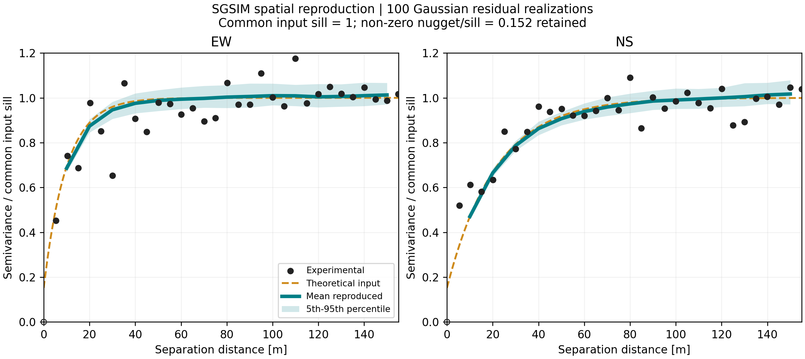
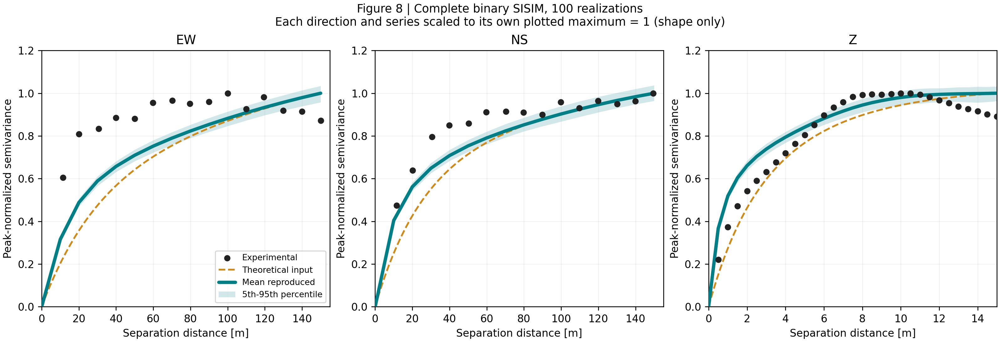
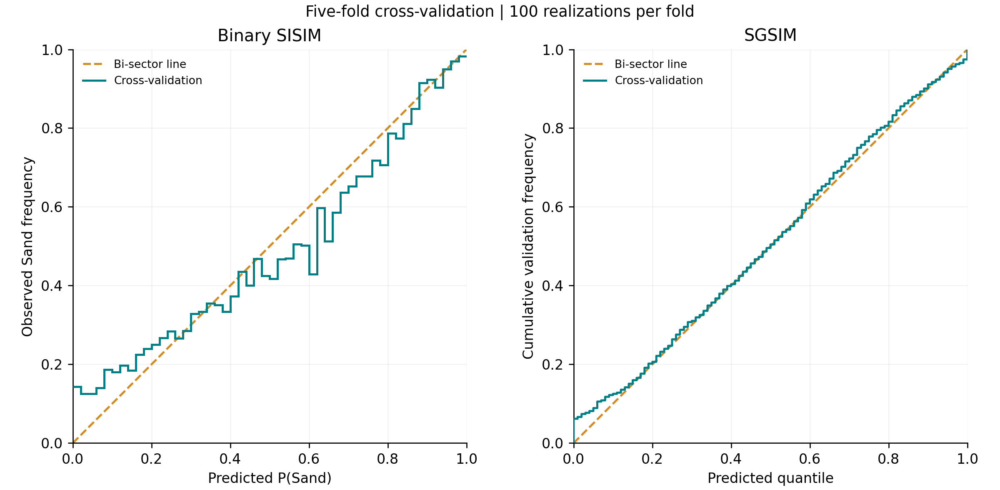

# GRID D2.2 — Geological modelling and uncertainty quantification

This repository provides a staged workflow for probabilistic subsurface modelling and uncertainty analysis from borehole data. It connects data quality assessment, geological interpretation, variography, conditional simulation, ensemble summaries and validation. The methodological background is provided in [Deliverable D2.1](docs/reports/D2_1_reference.docx).

Continuous geological boundaries are represented with sequential Gaussian simulation (SGSIM), and categorical lithology with sequential indicator simulation (SISIM). A hierarchical combination produces geological realizations from which class probabilities, the most likely class, entropy and variability are calculated.

The workflow is illustrated with a Munich borehole dataset. The domain, geological interpretation and covariance parameters are configured for this reference case.

## Workflow

```text
Borehole records
  -> quality assessment and geological preparation
  -> statistical preparation and variography
  -> continuous and categorical conditional simulation
  -> hierarchical geological realizations
  -> uncertainty summaries and validation
```

| Stage | Script | Main products |
| --- | --- | --- |
| 01 | `scripts/01_Data_Quality_and_Preparation.py` | Quality flags, composites, boundary observations, trends and transformed residuals |
| 02 | `scripts/02_Variography.py` | Directional experimental variograms, candidate fits and adopted parameters |
| 03 | `scripts/03_Simulation.py` | Continuous surfaces, categorical fields and paired geological realizations |
| 04 | `scripts/04_Uncertainty_Quantification.py` | Class probabilities, mode, entropy, variability, boundary statistics and stability diagnostics |
| 05 | `scripts/05_Validation.py` | Hard-data checks, spatial continuity diagnostics and submodel cross-validation |

See the [function mapping](docs/MAPPING.md) for the relationship between the staged scripts and the original numerical routines.

## Installation

The supported execution environment is Windows with Python 3.12. Run these commands from the repository root:

```powershell
py -3.12 -m venv .venv
.\.venv\Scripts\python.exe -m pip install -r requirements.txt
.\.venv\Scripts\python.exe -B -m unittest discover -s tests -v
```

Simulation requires an external GSLIB90 installation containing `varmap.exe`, `gamv.exe`, `gam.exe`, `sgsim.exe` and `sisim.exe`. These executables are not redistributed here.

## Run the workflow

A small-grid smoke profile exercises the staged implementation:

```powershell
$env:GSLIB_DIR = 'C:	oolsgslib90'
.\.venv\Scripts\python.exe run_workflow.py --config configs/smoke.json --run-dir runs/smoke --verify-preparation --sweep
.\.venv\Scripts\python.exe scripts/verify_run.py --config configs/smoke.json --run-dir runs/smoke
```

The smoke profile uses the included real borehole subset, a 24 × 24 × 40 grid and 100 realizations. Cross-validation runs by default; add `--skip-cv` to omit it. The `--sweep` flag evaluates the supplied continuous lag/tolerance combinations.

For a larger model, select an explicit configuration and a fresh run directory:

```powershell
.\.venv\Scripts\python.exe run_workflow.py --config configs/example_1km.json --run-dir runs/example_1km --verify-preparation
```

Use `--wd` to select an input-data directory containing `data/bohrungen_epsg25832_shp/`. Completed stages save logs and manifests. To resume, use `--from-stage`; failed stage directories must first be archived outside their numbered location. Use a new run directory when changing configuration.

## Adapting the method to another site

Set the coordinate system, domain, discretization and selected variogram parameters in a configuration file. Review the geological interpretation and category mapping separately: the supplied DIN grouping and Quaternary-base extraction are specific to the Munich example. Some search controls, kriging options and realization settings remain implementation constants in `scripts/workflow_support.py`.

Quality flags identify records for review, with preparation exclusions recorded separately. The ensemble quantifies uncertainty conditional on the adopted data interpretation and spatial model.

## Current Munich article results - 18 October 2026

The current article uses `configs/exponential_sisim_final_20261018.json`: a zero-nugget SISIM input with four nested exponential structures and calibrated directional ranges. The selected model has 100 spatial realizations and grouped five-fold SISIM validation with 100 realizations per fold (500 CV realizations).

- [Article reproduction guide](docs/article/REPRODUCE.md)
- [Current figures](docs/article/FIGURES.md)
- [Spatial and probability validation](docs/article/VALIDATION.md)
- [Full parameter and calculation record](docs/final_20261018/README.md)
- [Borehole provenance and selection](data/real_munich/README.md)
- [Current terrain-masked 3D model, gzip compressed](vtk/model_gok_sisim_final_20261018.vtk.gz)







Run the current input explicitly with a fresh output directory and the external GSLIB tools:

```powershell
python run_workflow.py --config configs/exponential_sisim_final_20261018.json --run-dir runs/article_final --verify-preparation --skip-cv
```

The [article guide](docs/article/REPRODUCE.md) describes the grouped cross-validation and preprocessing. Check the bundled results and redraw the figures:

```powershell
python scripts/verify_final_validation.py
python scripts/plot_sgsim_reproduction.py
python scripts/plot_final_variograms.py
python scripts/refresh_final_model_figures.py
python scripts/plot_final_calibration.py
python scripts/publish_article_figures.py
```

Article figures are in `pics/`, with redraw inputs in `pics/final_20261018/` and a file index in `pics/current_article.json`. Figures 07-08 compare direction-wise peak-normalized variogram shapes; Figure 08 includes the complete binary SISIM grid. Raw amplitude errors and probability-calibration metrics are reported in the [validation summary](docs/article/VALIDATION.md).

The SGSIM reproduction panel uses 100 Gaussian residual fields in EW/NS, scaled by a common total input sill with its non-zero nugget.

The 3D model is supplied as a gzip-compressed VTK. Decompress it to `model_gok_sisim_final_20261018.vtk` before opening it in a visualization application.

## Repository and provenance

`scripts/` contains the staged workflow and numerical routines; `configs/` contains example profiles; `data/` contains the input subset and reference terrain; `tests/` contains regression checks. `legacy/Workflow_U9_Wang.py` is the original interactive reference. Use `run_workflow.py` to execute the staged workflow.

Implementation provenance and version checks are documented in the [source records](docs/core_source_localization.json). Earlier calculation and release records are described in the [technical record](docs/final_20261018/README.md#calculation-records).

The repository license is [GNU Affero General Public License v3.0](LICENSE). Author notices and dependency provenance are in [THIRD_PARTY.md](THIRD_PARTY.md). Windows CI runs the regression tests and packaged-result checks.
